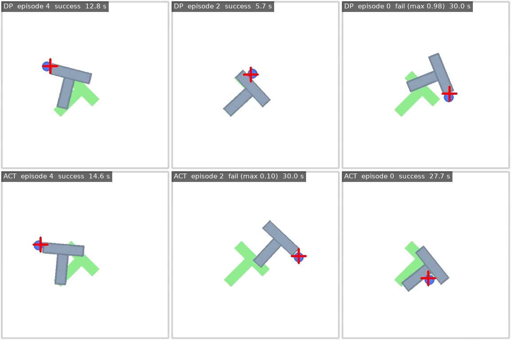
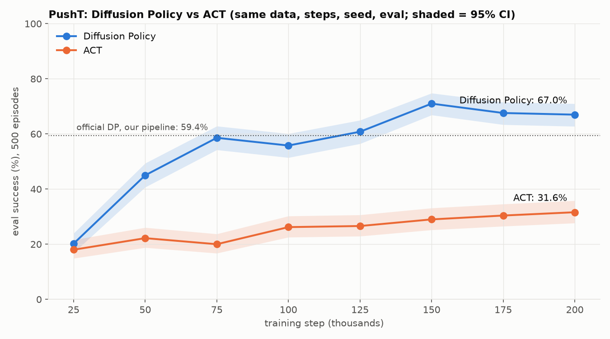

# Diffusion Policy vs ACT on PushT

Reproducing LeRobot's Diffusion Policy on the PushT benchmark and comparing it with ACT, trained and evaluated on the University of Utah CHPC GPU cluster (Slurm, NVIDIA A800).



*Top: Diffusion Policy. Bottom: ACT. Each column starts from the same state (same eval seed). Video: [`results/demo/dp_vs_act_grid.mp4`](results/demo/dp_vs_act_grid.mp4), 2× speed.*

## Results

500 evaluation episodes per model, all on the same 500 starting states (seed 1000).

| Policy | Success | 95% CI | Avg max overlap | Train time (A800) |
|---|---|---|---|---|
| Official `lerobot/diffusion_pusht`, reported by LeRobot | 65.4% | | 0.955 | ~7 h (RTX 3090) |
| Official `lerobot/diffusion_pusht`, re-evaluated here | 59.4% | 55.0–63.6 | 0.941 | |
| **My Diffusion Policy (200k steps)** | **67.0%** | 62.8–71.0 | 0.946 | 3.5 h |
| **My ACT (200k steps)** | **31.6%** | 27.7–35.8 | 0.645 | 1.5 h |

Paired (McNemar) tests on the same starting states:
- My DP vs. the official model in this pipeline: p = 0.009.
- My DP vs. ACT: p ≈ 4 × 10⁻³¹.



## Findings

1. **The official Diffusion Policy result reproduces.** 67.0% vs. 65.4% reported. This needed the official config, not LeRobot 0.6.2's defaults: six Diffusion Policy defaults have since changed (crop, horizon 16 → 64, action steps 8 → 32, ImageNet backbone, BatchNorm, per-camera encoder). Training with the defaults would silently train a different model.
2. **DP beats ACT by 35 points on PushT, and the two fail differently.**
   - 66% of DP's failures are near misses (max score ≥ 0.9: the block is almost aligned).
   - 68% of ACT's failures are clear misses (score < 0.8, median 0.43).
   - This is consistent with PushT's multimodal demonstrations (the block can be pushed around either side). A diffusion model can commit to one mode; ACT's regression tends to average them.
3. **50-episode evaluations are too noisy to compare checkpoints.** The in-training evals (50 episodes, ±13%) showed DP flat at ~66% from 100k steps on. The 500-episode evals show 55.8% at 100k rising to 67–71% at 150k–200k: the second half of training mattered.

## Setup

| | |
|---|---|
| Data | [`lerobot/pusht`](https://huggingface.co/datasets/lerobot/pusht): 206 human demos, 25,650 frames, 96×96 RGB + agent (x, y), 10 Hz |
| Simulator | `gym-pusht` 0.1.8. Success = block overlaps the target by > 95%, within 300 steps |
| Software | LeRobot 0.6.2 (commit `dd5313e`), PyTorch 2.11 (CUDA 13.0), Python 3.12 |
| Training (both) | 200k steps, batch 64, seed 100000, 1× A800 40 GB |
| Diffusion Policy | Official `lerobot/diffusion_pusht` config (263M params): crop 84×84, horizon 16, 8 action steps, 100 DDPM steps, ResNet18 from scratch with GroupNorm |
| ACT | No official PushT config exists. LeRobot defaults (52M params, ImageNet ResNet18, VAE), with `chunk_size=16`, `n_action_steps=8` to match DP's re-planning interval. ACT's default chunk of 100 assumes 50 Hz ALOHA; at PushT's 10 Hz it would be 10 s open loop |

## Limitations

- **One training seed per method**, so run-to-run variance is unknown.
- **ACT was not tuned.** Its PushT config is my choice (above). Other learning rates, KL weights or chunk sizes might narrow the gap.
- **The official model scores 6 points lower here than reported (59.4% vs 65.4%, borderline significant).** Likely causes, not yet tested: library versions, the migration of its normalization format, hardware numerics.
- **The best checkpoint is not the reported one.** DP's best is 150k (71.0%), but it was picked on the test episodes, which inflates it; it is not significantly better than 200k (p = 0.15). The headline uses the pre-chosen final checkpoint.

## Reproduce

All jobs run on CHPC `granite` with account and partition `kmarino` / `kmarino-gpu-grn`. Downloads happen on the login node; jobs run offline.

```bash
# environment (login node)
module load miniforge3/25.11.0 && eval "$(conda shell.bash hook)"
conda create -y -p ~/envs/lerobot python=3.12 && conda activate ~/envs/lerobot
conda install -y ffmpeg -c conda-forge
git clone --depth 1 https://github.com/huggingface/lerobot.git && pip install -e "lerobot[pusht,diffusion,training]"

# check the environment on a GPU node (1 min)
sbatch jobs/check_env.slurm

# train: <run> <steps> <save+eval every> <eval episodes>; reruns resume from the last checkpoint
sbatch jobs/train_dp.slurm  dp_run1  200000 25000 50
sbatch jobs/train_act.slurm act_run1 200000 25000 50

# evaluate checkpoints (500 episodes each)
sbatch jobs/eval_ckpt.slurm dp_run1 500 25000 50000 75000 100000 125000 150000 175000 200000

# analysis
python analysis/training_log.py logs/train_dp-<jobid>.out results/dp_run1 59.4
python analysis/checkpoint_curve.py dp_run1 59.4
python analysis/compare_policies.py
python analysis/make_video_grid.py
```

The official model has to be migrated to LeRobot 0.6's processor format first: `python tools/migrate_official.py --pretrained-path lerobot/diffusion_pusht --output-dir <dir>`. This wrapper fixes a list-vs-tuple bug in LeRobot's migration script.

## Repository layout

```
jobs/       Slurm scripts: check_env, train_dp, train_act, eval_official, eval_ckpt
analysis/   dataset exploration, log parsing, curves, video grid
tools/      migrate_official.py
results/    eval_info JSONs, CSVs, figures, demo video
reports/    phase reports, including the problem log
models/     final DP and ACT checkpoints (not committed: 1.2 GB)
```

## Notes from the cluster

Engineering issues hit along the way, with causes and fixes, are in [`reports/`](reports/). Highlights:
- An owner partition that rejects jobs without its QOS.
- A Hugging Face offline-mode dataset lookup.
- Parallel eval workers that never import the simulator.
- A Slurm job script that reported failed runs as COMPLETED because it ended with `echo`.
